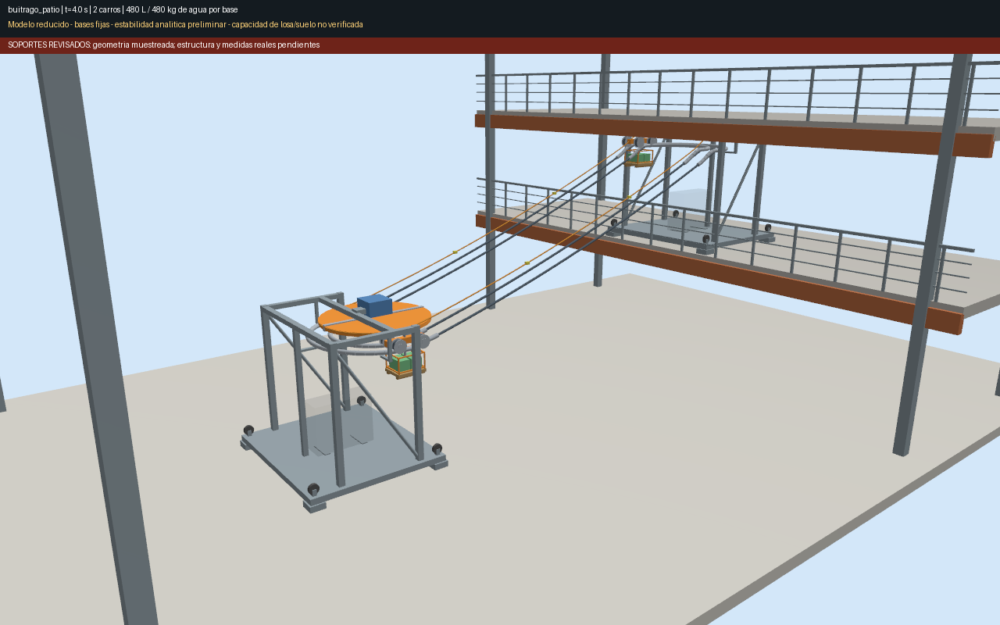
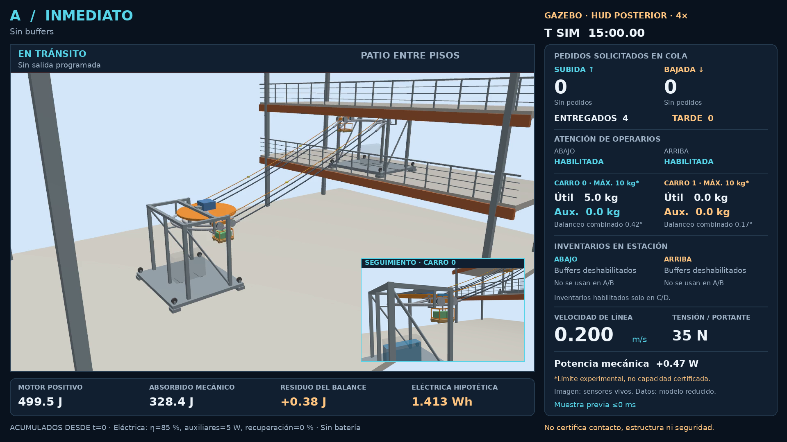
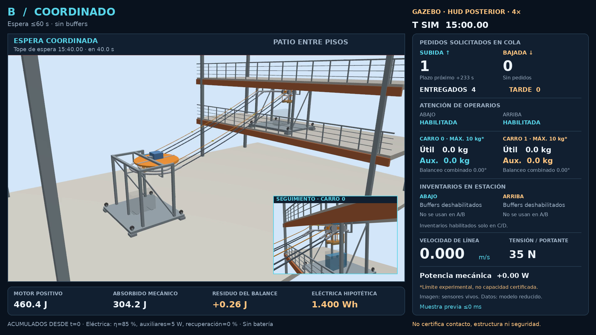
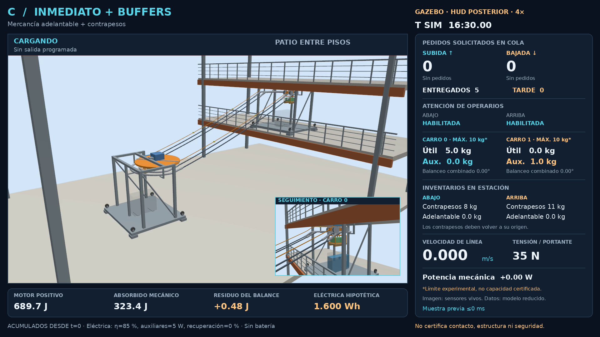
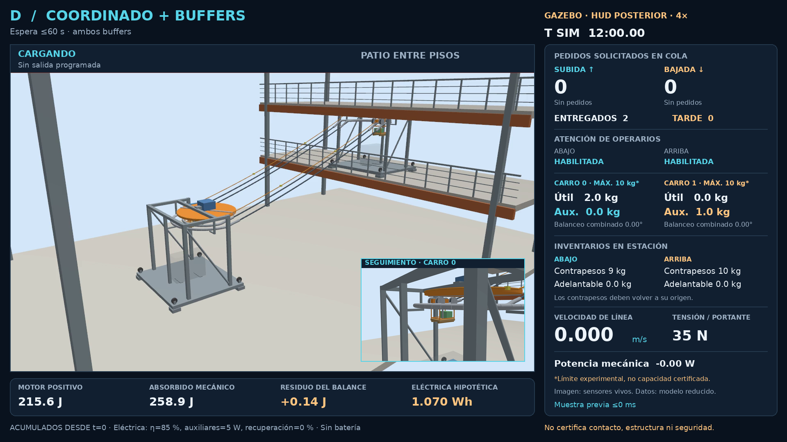
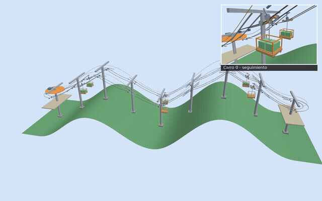

# AgroTeleférico

**Transporte de carga por cables: un piloto para comparar entregas, esperas y consumo energético.**

El piloto actual conecta dos niveles de un patio con **un vano, dos carros
acoplados y bases con lastre**. Estudia cómo atender cargas que deben subir y
bajar, con demanda variable, plazos de entrega y operarios con turnos de atención.
La pregunta es cuándo conviene despachar de inmediato, esperar para coordinar
cargas o usar inventarios auxiliares para equilibrar el transporte.

**[Resultados del piloto](docs/resultados_demanda.md)** ·
**[Vídeos y assets para la propuesta](docs/assets_propuesta.md)** ·
**[Descargas en GitHub](https://github.com/dryanguasr/AgroTeleferico/releases/tag/piloto-demanda-20261029)**

## El piloto actual

El escenario tiene **3,20 m de desnivel en 8,60 m horizontales**, con dimensiones
supuestas para la demostración. Los soportes exteriores separan depósito,
bastidor y recorrido. Los dos carros comparten un accionamiento central y
recorren el circuito en un único sentido; la subida y la bajada de mercancía
se realizan en sus tramos respectivos.

Se comparan cuatro políticas sobre exactamente las mismas realizaciones de demanda:

| Política | Cuándo despacha | Buffers disponibles |
|---|---|---|
| **A · Inmediato** | Al disponer de carga y operarios | Sin buffers |
| **B · Coordinado** | Espera hasta 60 s para coordinar, limitada por los plazos conocidos | Sin buffers |
| **C · Inmediato con buffers** | Al disponer de carga y operarios | Mercancía adelantable y módulos de contrapeso |
| **D · Coordinado con buffers** | Coordina cargas con espera y plazos | Mercancía adelantable y módulos de contrapeso |

Los contrapesos móviles son distintos del lastre fijo de las bases. Cada réplica
incluye la entrega de todos los pedidos y la restitución final de los módulos;
ese tiempo y esa energía forman parte del resultado.

### Cuatro vídeos de la misma demanda

| A · Inmediato | B · Coordinado |
|---|---|
|  |  |
| **C · Inmediato con buffers** | **D · Coordinado con buffers** |
|  |  |

Cada miniatura abre un MP4 descargable: **1080p, 20 fps, 150 s y reproducción 4×**.
Los cuatro muestran la semilla 26, con 24 pedidos/h y predominio alternado,
durante los minutos simulados 10–20. Es una ejecución representativa elegida
por una regla fija de proximidad a la mediana, no el promedio de la campaña.

Las imágenes proceden de sensores Gazebo. El HUD incorpora telemetría
sincronizada de colas, plazos, operarios, cargas, inventarios, velocidad,
tensión y energía. Las cifras eléctricas están identificadas como hipotéticas.

## Qué muestran los resultados

La campaña usa demanda sintética de **12, 24 y 36 pedidos/h**, con reparto
equilibrado o predominio alternado de subida y bajada. Cada réplica recibe
pedidos durante una hora y continúa hasta completar entregas y restitución.
Treinta semillas compartidas por condición y las cuatro políticas suman
**720 ejecuciones comparables, auditadas individualmente**.

En el caso nominal de **24 pedidos/h y predominio alternado**, las medias son:

| Política | Pedidos dentro del plazo | Trabajo motriz positivo | Electricidad estimada¹ |
|---|---:|---:|---:|
| A | 94,15 % | 1881,83 J | 5,970 Wh |
| B | 93,13 % | 1675,01 J | 5,968 Wh |
| C | 95,05 % | 1826,87 J | 6,041 Wh |
| D | 93,99 % | 1654,28 J | 6,066 Wh |

¹ Por réplica completa, con eficiencia motriz del 85 %, auxiliares de 5 W
durante todo el tiempo encendido y sin recuperación del trabajo absorbido.
Son estimaciones del modelo, no mediciones de una instalación.

**Inferido de la campaña:** C ofrece el mayor cumplimiento medio en las seis
condiciones, con evidencia más clara de mejora frente a A en demanda alta.
Con poca demanda, A ofrece un compromiso sencillo. La espera reduce trabajo
mecánico, pero el consumo auxiliar durante el tiempo adicional puede absorber
ese ahorro. Los buffers favorecen principalmente el servicio en estos ensayos;
su ventaja eléctrica depende de los supuestos. En el caso nominal, los intervalos
del cambio de cumplimiento de B, C y D frente a A incluyen cero.

El [informe completo](docs/resultados_demanda.md) presenta diferencias pareadas,
intervalos del 95 %, retrasos, ocupación, restitución y sensibilidad eléctrica.
Permite evaluar el compromiso entre servicio y energía sin suponer una política
universalmente superior.

### Evidencia y alcance

- **Verificado:** 720/720 ejecuciones comparables y auditadas; cuatro casos
  representativos con seis CSV idénticos entre CLI y Gazebo; cuatro vídeos
  sincronizados; 14/14 pruebas CTest aprobadas antes de publicar.
- **Inferido:** las comparaciones entre políticas describen las demandas
  sintéticas y el modelo reducido ensayados.
- **Pendiente:** medición eléctrica y validación experimental del equipo físico,
  contacto, resistencia, fatiga y bases/suelo. La simulación no certifica
  capacidad estructural ni seguridad.

## Modelo, reproducción y documentación

El entorno usado es **Ubuntu 24.04, ROS 2 Jazzy y Gazebo Harmonic**, también
desde WSL en Windows. El modo de demanda es opcional y conserva el programa
histórico predeterminado.

- [Diseño del experimento y ejecución de la campaña](docs/piloto_demanda.md)
  y [configuración reproducible](config/demand_pilot.json).
- [Especificación matemática, unidades y contratos vigentes](docs/modelo_vigente.md).
- [Geometría y soportes del patio](docs/soportes_revisados.md).
- [Correcciones del modelo y pruebas](docs/consolidacion_modelo.md)
  y [validación mínima en Gazebo y ROS](docs/validacion_minima_20261026.md).
- [Assets para la propuesta](docs/assets_propuesta.md): vídeos, miniaturas,
  figura editable, tablas y evidencia con hashes.
- [Guía técnica del repositorio](docs/guia_tecnica.md).

## Motivación y posibles extensiones

La motivación del proyecto es explorar cómo mover cosecha y suministros por
terrenos inclinados o entre puntos de difícil acceso. El patio actual permite
estudiar primero la coordinación de cargas y sus costes en un escenario acotado.
Los pilotos anteriores documentan conceptos que podrían extender esa base.

### De un carro a una plataforma por cables

| Un cable | Dos cables | Ocho cables |
|:---:|:---:|:---:|
|  |  |  |
| Antecedente para estudiar recorridos de ida y vuelta con carga suspendida. | Antecedente para estudiar balanceo y reparto entre portantes paralelos. | Concepto para mover y orientar una plataforma mediante varios cables. |

Estos ensayos exploran movimiento, estabilidad y perturbaciones sobre una ladera.
Sus [resultados históricos](docs/resultados.md) y [vídeos](docs/videos.md)
sirven como referencia para posibles aplicaciones agrícolas con otras geometrías.

### Circuitos con más carros, inspirados en las garruchas

Otro antecedente explora **seis carros** sobre terreno irregular. La revisión
con **nueve postes en T, separados 6 m**, y jaulas abiertas aporta una referencia
visual para un posible circuito de mayor extensión. Su captura es parcial;
el vídeo completo archivado corresponde a la variante anterior de 13 apoyos.

| Material histórico | Alcance |
|---|---|
| [Circuito de 13 apoyos · 85 s](docs/evidence/loop/native/capture/gazebo.mp4) | Recorrido completo, carga, descarga y ráfaga. |
| [Postes en T y garruchas · 31 s](docs/evidence/loop/garruchas/gazebo_pip_partial.mp4) | Fragmento de la revisión de nueve apoyos, con seguimiento del carro. |
| [Detalle de una garrucha · 31 s](docs/videos/garrucha_seguimiento_parcial.mp4) | La misma ejecución parcial, vista de cerca. |

El [informe del circuito histórico](docs/informe_nativo_circuito.md) y su
[punto de retomada](docs/revision_garruchas.md) conservan la evidencia y los
pendientes de esa línea. Extender las conclusiones del patio a laderas,
múltiples vanos o más carros requerirá campañas específicas.

[Referencias y motivación técnica](docs/referencias.md) ·
[Alcance general de validación](docs/validacion.md) ·
[Licencia MIT](LICENSE)
