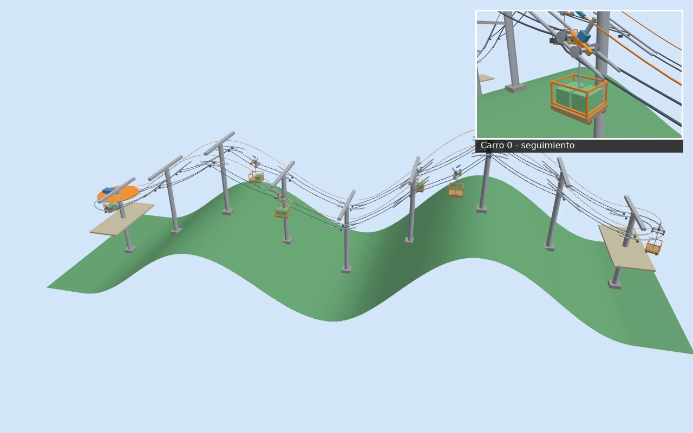

# AgroTeleferico

## Piloto actual: un vano, dos carros y bases con lastre

El patio despejado conecta el primer piso con el segundo: **3,20 m de
desnivel en 8,60 m horizontales**, con cotas supuestas del edificio conceptual.
Los soportes exteriores separan depósito, bastidor y recorrido de los carros.
La revisión geométrica incluye ruedas, acoples, suspensión y carga frente a
soportes y edificio; no sustituye una validación estructural o de contacto.

**[Diseño, comprobaciones y ejecución](docs/soportes_revisados.md)** ·
**[Seguimiento del carro](docs/evidence/single_span_revised/capture_patio/follow.mp4)** ·
**[Resultados verificables](docs/evidence/single_span_revised/metrics.json)**

Las propuestas y capturas que siguen documentan etapas anteriores del proyecto.

**Robots por cables para explorar el transporte agrícola en laderas.**

¿Cómo mover una cosecha sobre un terreno inclinado? Este piloto explora distintas
formas de transportar carga suspendida: desde un carro sencillo hasta una
plataforma que se mueve y orienta mediante ocho cables.

*Fragmento de la simulación en Gazebo, acelerado 4×. La vista general incluye
un recuadro que sigue a uno de los carros. Haz clic para abrir el vídeo parcial.*

**[Ver vídeos](docs/videos.md) · [Explorar resultados](docs/resultados.md) · [Cómo ejecutarlo](docs/guia_tecnica.md)**

## Del cable sencillo al control en ocho cables

Tres propuestas para comparar movimiento, estabilidad y control sobre una ladera:

| Un cable | Dos cables | Ocho cables |
|:---:|:---:|:---:|
|  |  |  |
| Un carro recorre un cable flexible, se detiene y regresa. | Dos portantes paralelos permiten estudiar el balanceo y el reparto de carga. | Una plataforma barre una zona y cambia de altura e inclinación. |

Las imágenes son capturas de las simulaciones. Los ensayos comparan cargas,
perturbaciones y precisión del movimiento; puedes consultar las cifras en
[los resultados del piloto](docs/resultados.md).

## Un circuito inspirado en las garruchas

La extensión más reciente lleva la idea a un recorrido con **seis carros**,
terreno irregular y operaciones de carga y descarga. La revisión visual incorpora
**nueve postes en T**, separados **6 metros**, y jaulas abiertas inspiradas en
las garruchas agrícolas.

### Mira el piloto en acción

| Vídeo | Qué encontrarás |
|---|---|
| **[▶ Circuito completo · 85 s](docs/evidence/loop/native/capture/gazebo.mp4)** | Recorrido, carga, descarga y ráfaga. Corresponde a la variante anterior de 13 apoyos. |
| **[▶ Postes en T y garruchas · 31 s](docs/evidence/loop/garruchas/gazebo_pip_partial.mp4)** | Vista exterior con recuadro de seguimiento. Captura parcial de la revisión actual. |
| **[▶ Detalle del carro · 31 s](docs/videos/garrucha_seguimiento_parcial.mp4)** | Ruedas, suspensión y jaula a resolución completa. La misma ejecución parcial, vista de cerca. |

Los enlaces abren los MP4 incluidos en el repositorio. Si no aparece un reproductor,
usa **View raw / Download**. La animación de arriba permite ver un fragmento
directamente en esta página. [Galería y evidencia de los vídeos →](docs/videos.md)

## Qué está listo y qué sigue

- **Piloto de tres escenarios:** simulaciones, pruebas y resultados documentados.
- **Circuito anterior de 13 apoyos:** recorrido completo y vídeo verificados.
- **Revisión con postes en T y garruchas:** implementada, con pruebas numéricas
  aprobadas y vídeo parcial. La grabación se detuvo para respetar la reserva de RAM.
- **Pendiente para después:** grabar el ciclo completo de esta última revisión,
  revisar descarga y regreso, y cerrar la comparación de sus resultados.

El trabajo automático está **suspendido**. El [punto de retomada](docs/revision_garruchas.md)
conserva los pasos pendientes y la evidencia disponible.

## Probarlo y conocer el proyecto

El entorno de ejecución es **Ubuntu 24.04, ROS 2 Jazzy y Gazebo Harmonic**,
también utilizado desde WSL en Windows.

- [Guía técnica: instalación, ejecución y comandos](docs/guia_tecnica.md).
- [Cómo ejecutar y grabar el circuito](docs/demo_circuito.md).
- [Resultados de los tres escenarios](docs/resultados.md) e [informe del circuito](docs/informe_nativo_circuito.md).
- [Proyectos de referencia](docs/referencias.md) y [cómo funciona el modelo](docs/modelo.md).

Este es un piloto de simulación para comparar conceptos. Las dimensiones y masas
son supuestos de demostración; todavía no es un diseño listo para construir o
instalar en una finca. [Alcance y validación](docs/validacion.md).

Código bajo [licencia MIT](LICENSE).
