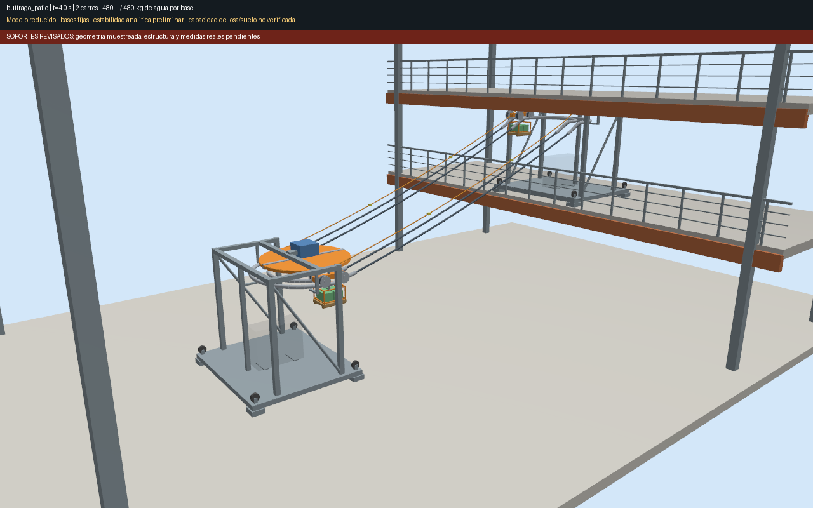
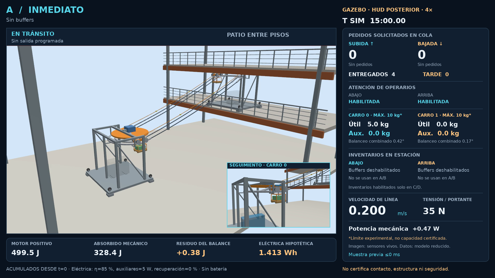
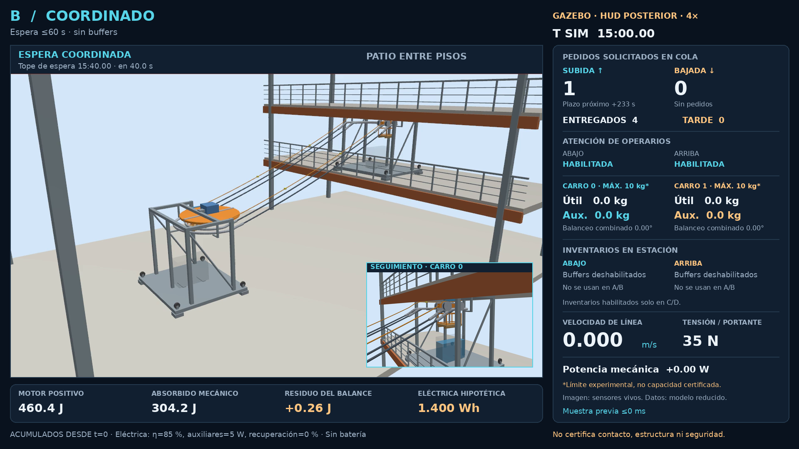

<div align="center">

# AgroTeleférico
### Simulación y decisión operacional para transporte agrícola por cables

**ROS 2 · Gazebo Harmonic · C++ · diseño experimental**

[Resultados comparativos](docs/resultados_demanda.md) · [Videos y capturas](docs/assets_propuesta.md) · [Reproducción](docs/reproduccion_demanda.md) · [Guía técnica íntegra](README_TECHNICAL.md)

</div>



## La pregunta de ingeniería

¿Cuándo conviene **despachar de inmediato, esperar para coordinar cargas o usar buffers**? El piloto analiza entregas, plazos, esperas y energía en un circuito hipotético de dos carros acoplados, con un vano y operarios de atención. No se presenta como una instalación lista para construir.

## Qué se puede explorar

| Dimensión | Implementación |
| --- | --- |
| Escenario | Desnivel de 3,20 m en 8,60 m horizontales; demanda y turnos sintéticos |
| Decisiones | Cuatro políticas: despacho inmediato/coordinado, con/sin buffers |
| Resultados | Cumplimiento de plazos, esperas, trabajo motriz y electricidad estimada |
| Evidencia | CSV, reportes, capturas sincronizadas y videos comparativos |

### Evidencia que respalda el piloto

La campaña del repositorio documenta **720 ejecuciones comparables y auditadas**. Con determinados niveles de demanda, coordinar cargas reduce el trabajo mecánico; sin embargo, el mayor tiempo de operación puede neutralizar ese ahorro en electricidad. Los resultados no justifican declarar una política universalmente superior. [Resultados, intervalos y supuestos](docs/resultados_demanda.md).

| A · Inmediato | B · Coordinado |
|:---:|:---:|
| [](https://github.com/dryanguasr/AgroTeleferico/releases/download/piloto-demanda-20261029/A_inmediato.mp4) | [](https://github.com/dryanguasr/AgroTeleferico/releases/download/piloto-demanda-20261029/B_coordinado.mp4) |

[Políticas C y D](docs/assets_propuesta.md) · [Descargar los videos](https://github.com/dryanguasr/AgroTeleferico/releases/tag/piloto-demanda-20261029).

## Empezar

Entorno completo documentado: **Ubuntu 24.04, ROS 2 Jazzy y Gazebo Harmonic**. Se puede compilar el modelo reducido sin ROS/Gazebo:

```bash
cmake -S . -B build -DAGRO_LOOP_STANDALONE=ON
cmake --build build
ctest --test-dir build --output-on-failure
```

Para ejecutar y auditar el sistema completo, consultar la [guía reproducible](docs/reproduccion_demanda.md) y la [configuración de demanda](config/demand_pilot.json).

## Alcance y límites de validación

- **Registrado en el repositorio:** comparaciones pareadas, pruebas CTest, paridad de escenarios y videos vinculados a telemetría.
- **Estimado:** consumo eléctrico mediante eficiencias y auxiliares supuestos, no medidos en hardware.
- **Pendiente:** validación física de elementos estructurales, contacto, resistencia, fatiga y soportes; el escenario de patio no certifica una ladera real.

[Modelo y unidades](docs/modelo_vigente.md) · [Diseño experimental](docs/piloto_demanda.md) · [Geometría](docs/soportes_revisados.md) · [README técnico anterior preservado](README_TECHNICAL.md) · [Licencia](LICENSE).

> Proyecto de investigación aplicada. Las contribuciones específicas y su evolución se consultan en el historial Git.
