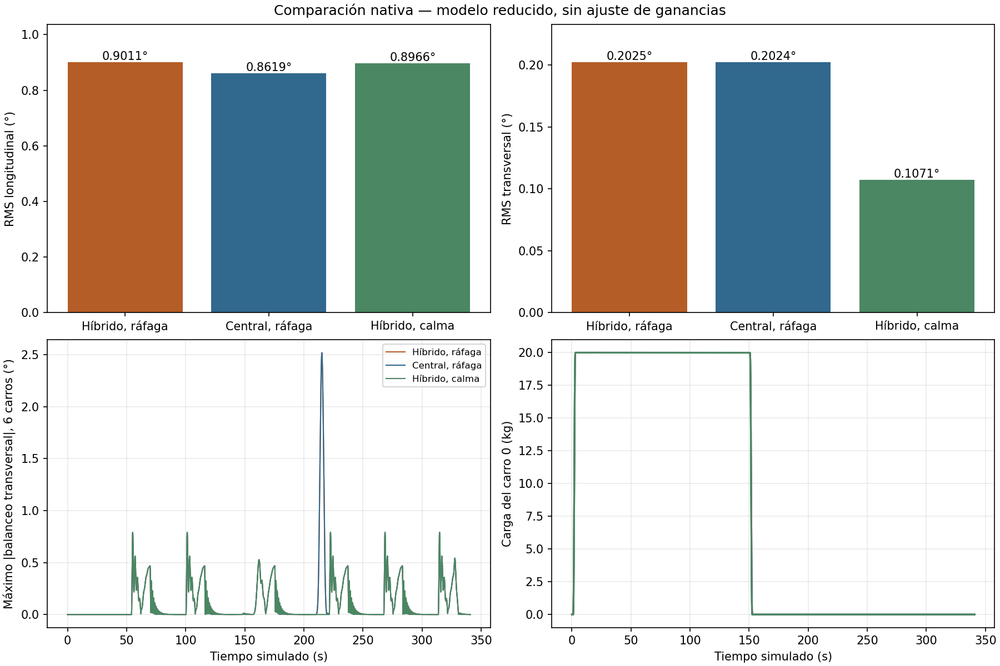

# Validación nativa del circuito: resultados

Estado: cinco servicios nativos y grabación completa verificados. Se entregan
datos, capturas y vídeo del modelo reducido, con los límites indicados abajo.
Base: `ffc699c45cdfa777e0220991229fef9c99879151`, rama
`feat/gazebo-loop-six-carriers`, con correcciones locales posteriores.

## Resultados comprobados

Los cinco servicios Gazebo completaron 340.802587245 segundos simulados con
salida normal. La comparación de todos los campos CSV y eventos con el núcleo
CLI aprobó en los cinco casos. El resumen, comprobaciones y archivos originales
comprimidos están en [evidence/loop/native](evidence/loop/native/manifest.json).
El manifiesto incluye SHA-256 de los ZIP; se comprobó también su CRC.

| Caso | Tiempo del supervisor (s) | Pico RSS del árbol (GiB) | Mínimo libre Windows (GiB) |
|---|---:|---:|---:|
| Híbrido con ráfaga | 688.31 | 3.475 | 7.30 |
| Central con ráfaga | 761.55 | 3.475 | 9.77 |
| Híbrido sin ráfaga | 704.13 | 3.476 | 10.89 |
| Híbrido, mitad del paso temporal | 769.46 | 3.475 | 11.71 |
| Híbrido, mitad del intervalo de forma | 785.93 | 3.475 | 12.21 |

El factor de tiempo real del núcleo/plugin en el caso nominal fue 0.5046;
el tiempo del supervisor de la tabla incluye arranque y cierre. No son la misma
medición. RSS suma procesos y puede contar páginas compartidas más de una vez.

La mayor variación relativa de las métricas de convergencia fue 0.0499632 %,
inferior al umbral del 5 %. La respuesta transversal con/sin ráfaga difirió
hasta 0.0439799 rad. El error máximo longitudinal de referencia fue
9.42e-5 m y la tensión máxima, 638.456 N.

El híbrido **empeoró un 4.5529 % el RMS longitudinal** frente al control central
en el servicio comparable con ráfaga. Se conserva el resultado negativo, sin
ajustar parámetros ni criterios para forzar una mejora.

## Compilación, interfaces y regresión

La compilación nativa Harmonic/Jazzy y la reinstalación incremental concluyeron.
CTest aprobó `physics`, `loop_core`, `loop_assets` y `loop_guard` (4/4).
La reinstalación final completó en 1 min 32 s y CTest en 2.34 s; se conservan
[log de compilación](evidence/loop/native/colcon_final.log) y
[log de pruebas](evidence/loop/native/ctest_final.log). El workflow de GitHub
Actions fue ampliado, pero no se ha ejecutado remotamente en esta entrega.
Las comprobaciones nativas de pausa, avance manual, reset con conservación del
resultado interrumpido, reinicio de reloj y parada aprobaron; véase
[lifecycle_checks.json](evidence/loop/native/lifecycle_checks.json).

La regresión rápida del piloto completó sus tres escenarios de 120 s. La suite
ampliada conserva 21 CSV de 120 s y 9 comparaciones de convergencia aprobadas.
Su informe se recuperó de los CSV después de una pausa humana: coincide con
los 20 informes originales existentes, pero el último código de salida y su
tiempo de pared no quedaron registrados. No se presenta como finalización
normal del supervisor ampliado. Las pruebas ROS de integración y saturación
también concluyeron con código 0. Los detalles y rutas originales constan en
[la bitácora](validacion_nativa_circuito.md).

## Correcciones y evidencia visual

Se corrigieron referencias de malla con espacios, material y normales del
terreno COLLADA, y tolerancia a lecturas transitorias de muestras de RAM sobre
DrvFS. El paso de escena es 10 ms; el núcleo conserva sus subpasos y la paridad
completa comprueba que esto no cambió los resultados de los cinco servicios.

El lanzador combinado de Gazebo dejó un servidor huérfano en una prueba
gráfica. Ahora servidor y GUI se lanzan por separado. La GUI usa Qt xcb y recibe
WM_DELETE_WINDOW únicamente en ventanas cuyo PID corresponde a esa instancia.
La prueba `loop_capture_three_smoke_06` obtuvo 21 fotogramas por cada una de
tres cámaras hasta 4 s, salida GUI=0, servidor=0, confirmación de parada y
ausencia de procesos residuales. Los cinco intentos anteriores permanecen
como evidencia fallida. La causa interna del bloqueo de SIGINT no se ha probado.

La grabación completa `loop_capture_complete_02` aprobó la verificación:
341 s simulados, 1.706 imágenes por cada una de tres cámaras, hueco máximo
0.2 s, vídeo H264 1280×800 a 20 fps, duración 85.3 s (4× nominal), decodificación
completa sin errores. GUI, servidor y supervisor terminaron con código 0 y el
servicio de parada respondió. La inspección posterior no encontró procesos
propios residuales. Los tres CSV coinciden byte a byte con el caso nominal
headless y los eventos son idénticos. Véanse [verificación](evidence/loop/native/capture/verification.json)
y [paridad](evidence/loop/native/capture/capture_parity.json).

Se revisaron las vistas general e inferior, descarga superior (150/153 s),
ráfaga (215/218 s), paso junto al motor (228 s) y retorno final (340 s).
No se observa un cruce evidente bogie/motor ni palet/plataforma en las vistas
críticas inspeccionadas. Las oclusiones de la rueda tractora y el muestreo
limitan esta revisión. La prueba de envolventes es conservadora e inconclusa;
no certifica ausencia de colisiones ni verifica envolventes continuas.

- [Vídeo completo en vivo](evidence/loop/native/capture/gazebo.mp4).
- [Vista general](evidence/loop/native/capture/overview_004s.png).
- [Estación inferior](evidence/loop/native/capture/lower_010s.png).
- [Antes de descarga](evidence/loop/native/capture/upper_150s.png) y [después](evidence/loop/native/capture/upper_153s.png).
- [Ráfaga](evidence/loop/native/capture/overview_215s.png) y [retorno final](evidence/loop/native/capture/overview_340s.png).

Durante esa grabación se cerró la GUI al acercarse la RAM libre a 5 GiB, después
de comprobar su PID y partición. El mismo servidor, sus tres cámaras y FFmpeg
continuaron sin reinicio. El RSS observado pasó de aproximadamente 8.18 a
4.38 GiB. La vista interactiva y las cámaras se distinguen expresamente: cerrar
la ventana no convierte las imágenes del sensor en un replay. El evento se
conserva en `capture/gui_release.json`.

El pico registrado fue 8.419 GiB de RSS y el mínimo libre Windows, 5.392 GiB.
La primera imagen llegó a los 10.205 s de pared. El intervalo de imágenes
tuvo factor simulado/pared 0.4437; el núcleo registró 770.689 s de pared y
factor 0.4422. Estas cifras incluyen fases con y sin ventana interactiva y no
son una medición exclusiva de uno de esos modos. La resolución 1280×800
prioriza una captura utilizable con render CPU; no se presenta como 1080p.

## Entorno y reproducción

Ubuntu 24.04.4 en WSL2, ROS 2 Jazzy, Gazebo Sim 8.11.0, WSLg 1.0.73.2,
FFmpeg 6.1.1. El equipo tiene RTX 4050 Laptop, pero las primeras capturas
usaron llvmpipe: no se debe atribuir aceleración GPU por la sola presencia de
la tarjeta. El log `capture/ogre2_during.log` confirma también llvmpipe
(LLVM 20.1.2, Mesa 25.2.8) durante `loop_capture_complete_02`.

Los comandos reproducibles están en [demo_circuito.md](demo_circuito.md).
El supervisor registra RAM Windows y RSS; se conserva al menos 4 GiB libres,
con parada preventiva bajo 5 GiB. El usuario coordina otros proyectos.
Tras medir el pico gráfico, la admisión con GUI se ajustó a 14 GiB; la reserva
no es un límite de RSS. La ejecución entregada conservó más de 5.39 GiB libres.

## Límites y siguientes experimentos

El plugin integra dinámica reducida en vivo y presenta sus poses mediante
modelos cinemáticos de Gazebo. No resuelve contacto rueda–cable. Los cables son
equilibrios elásticos cuasiestáticos multivano y los palets tienen dos modos
pendulares. El acoplamiento energético está incompleto; absorción mecánica no
equivale a recuperación eléctrica. Las reacciones negativas requieren
retenciones. Las limitaciones de [concepto_circuito.md](concepto_circuito.md)
siguen vigentes.

Como siguiente trabajo, estudiar envolventes continuas y oclusiones, identificar
parámetros físicos y cerrar los acoplamientos energéticos antes de extrapolar
a una instalación real. No se ha fusionado main. La bitácora conserva los
intentos fallidos y parciales; no se contabilizan como aprobados.
