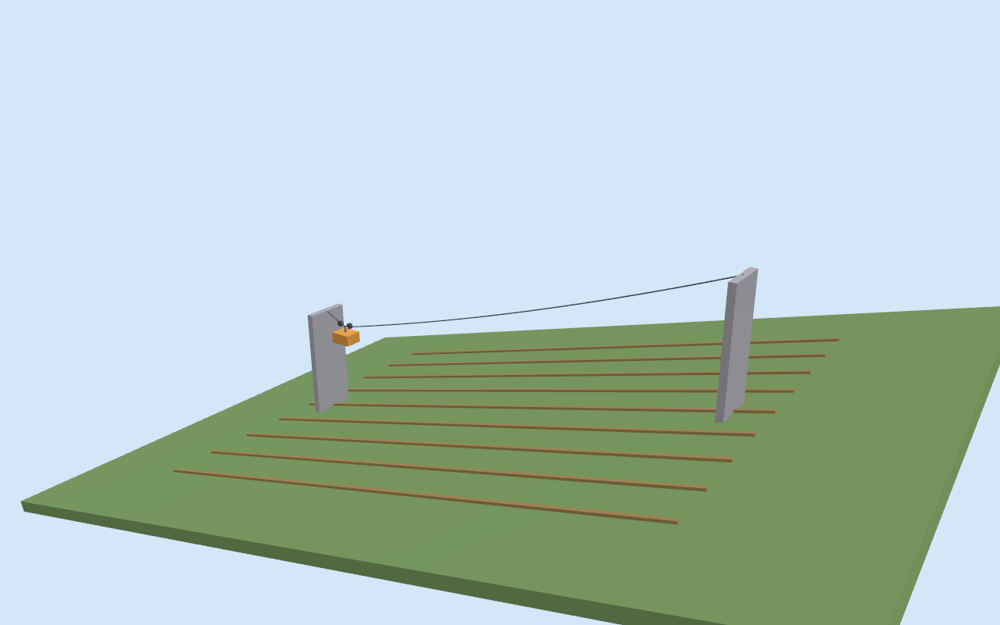
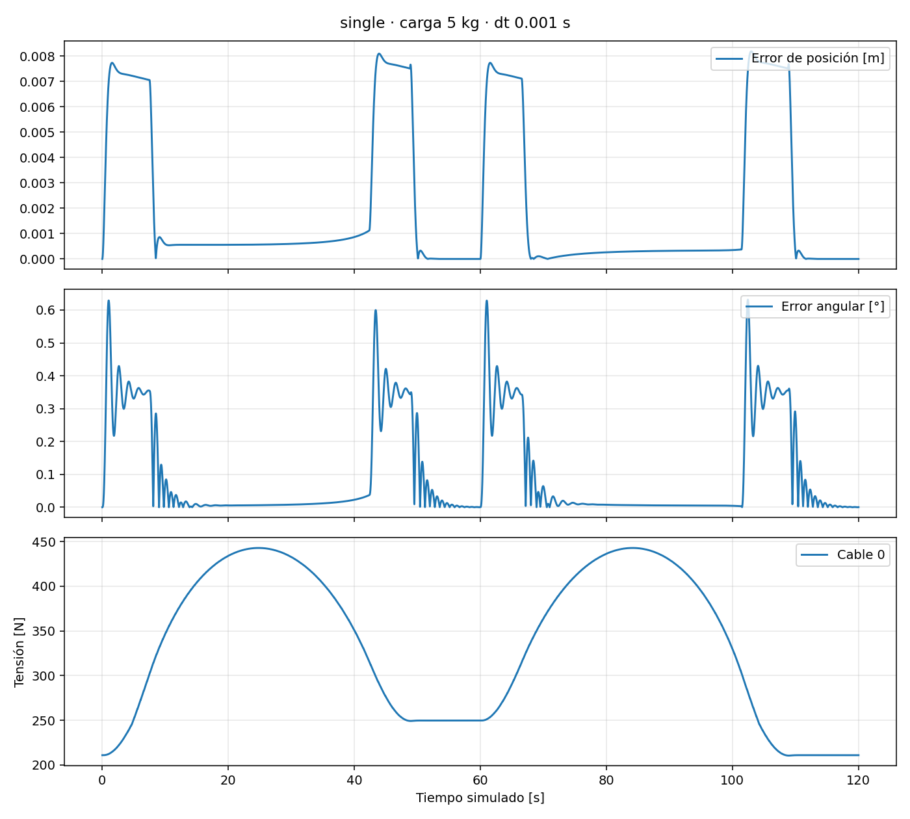
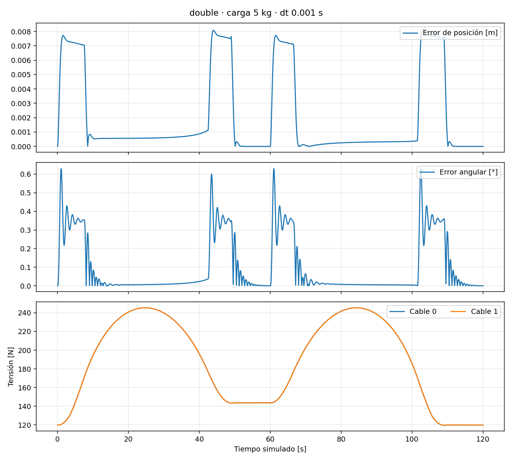
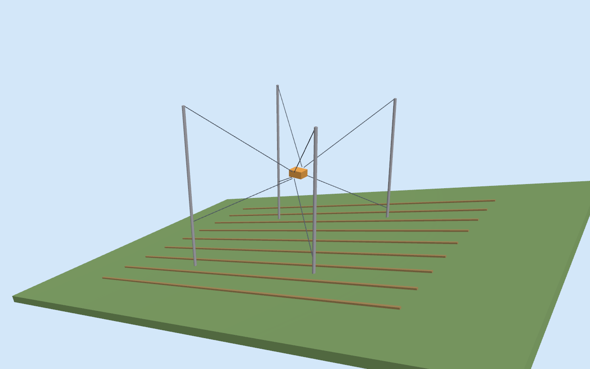
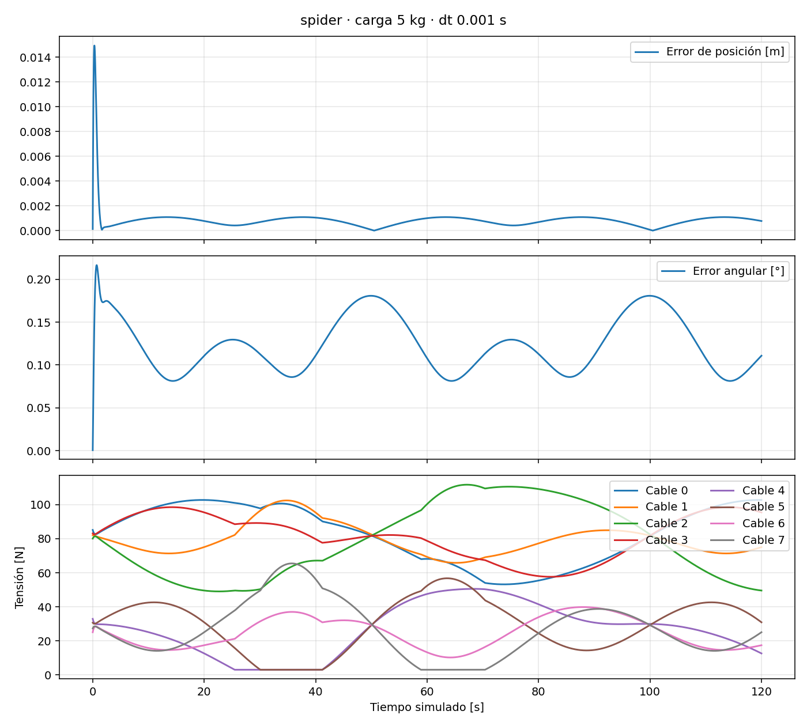

# Resultados del piloto

## Piloto actual de un vano y dos carros

El patio conecta pisos separados 3,20 m y usa soportes exteriores con lastre.
La campaña revisada, los ensayos con poco lastre, la revisión de interferencias
y las limitaciones están en [Soportes revisados](soportes_revisados.md).
Los datos verificables se conservan en el
[manifiesto de evidencia crítica](evidence/single_span_revised/manifest.json).

## Resultados de etapas anteriores

Ejecución local verificada en Ubuntu 24.04 / WSL, ROS 2 Jazzy y Gazebo Harmonic 8.11.0.

**Matriz de validación: 21 ensayos, resultado APROBADO.**
Cada ensayo cubre 120 segundos simulados. Los valores siguientes corresponden a carga útil de 5 kg y paso de 1 ms.

| Escenario | RMS posición [mm] | RMS angular [°] | Tensión máxima [N] |
|---|---:|---:|---:|
| single | 3.516 | 0.179 | 442.71 |
| double | 3.513 | 0.178 | 245.37 |
| spider | 0.811 | 0.127 | 111.76 |

Máxima diferencia de las métricas al reducir el paso a 0,5 ms: **0.205 %** (criterio <5 %; suelos de normalización definidos en el protocolo).

Los carros usan error longitudinal y la plataforma error 3D; sus RMS no son medidas intercambiables de capacidad de trabajo.

## Verificaciones adicionales

- Equilibrio y flecha analítica de catenaria; tensión unilateral; rango y factibilidad de las ocho cuerdas a lo largo del barrido, con tres masas.
- ROS 2: recepción de telemetría, aceptación de objetivos y rechazo de objetivos fuera de dominio para carro y plataforma.
- Dos ensayos degradados: baja adherencia y cabrestantes demasiado lentos. Ambos detectan saturación y pérdida de seguimiento; no se cuentan como ensayos nominales aprobados.
- GUI de Gazebo abierta en WSLg y escenas inspeccionadas mediante una cámara del motor Ogre2.
- Compilación independiente desde cero y repetición de los tres ensayos nominales: APROBADA.

## Balanceo ante perturbación lateral

| Escenario | Máximo roll [°] | RMS posición [mm] |
|---|---:|---:|
| single | 12.697 | 3.516 |
| double | 4.385 | 3.513 |
| spider | 3.438 | 8.167 |

Fuerza de 20 N durante un segundo. La reducción de balanceo del doble portante refleja la rigidez lateral equivalente asumida; requiere identificación física antes de extrapolarse.

## Escenas y gráficos

### single

### double

### spider

## Reproducibilidad y límites

Los CSV, SDF, logs y videos se entregan como archivos generados; el repositorio conserva los resúmenes medidos en [evidence](evidence/summary.json). La suite de CI vuelve a producir los datos completos.

Para grabar la cámara de Gazebo: `python3 scripts/capture_scene.py --headless --video --scenario spider --output results/recorded/spider`. Requiere los bindings Python `gz.transport13`/`gz.msgs10`, Pillow, ffmpeg y un renderizador disponible. Los tiempos de cada fotograma se guardan en `frame_times.csv`.

Para reproducir la trayectoria medida en un gráfico: `python3 scripts/render_replay.py results/suite/spider_p5_dt0.001/telemetry.csv --scenario spider --output results/videos/spider.mp4`. Estos videos se rotulan como reproducción de telemetría, no como captura de GUI.

La catenaria de los carros es cuasiestática; la plataforma usa cables rectos sin masa y la inercia asumida. No se han validado tensiones ni motores contra hardware. Ver [modelo](modelo.md), [protocolo](validacion.md) y [referencias](referencias.md).

La compilación en el volumen compartido Windows/WSL produjo avisos de reloj del sistema de archivos; terminó correctamente y se repitió en un directorio de compilación vacío. Las advertencias de antialiasing del renderizador no impidieron generar las imágenes.
