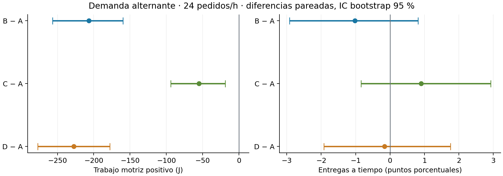

# Resultados del piloto de demanda y buffers

**Verificado:** 720/720 ejecuciones completadas y comparables, 0 fallidas, 0 pendientes; auditoría independiente aprobada en las 720. Las 30 semillas permanecen en cada grupo. Los 47 archivos históricos del manifiesto permanecen intactos. Las fuentes y el binario coinciden con la campaña; no se mezclan los intentos preliminares.

Los supuestos y el contrato de operación se describen en [piloto_demanda.md](piloto_demanda.md). Las medias de cumplimiento siguientes son medias de las fracciones de cada semilla, no una fracción agregada de todos los pedidos.

## Caso nominal: 24 pedidos/h, predominio alternado

| Política | Motor positivo medio J | J/kg útil medio | Pedidos a tiempo % | Masa a tiempo % | p95 retraso medio s | Tiempo medio s | Módulos transportados kg |
|---|---:|---:|---:|---:|---:|---:|---:|
| A | 1881.83 | 18.008 | 94.15 | 93.69 | 30.68 | 3855.80 | 0.00 |
| B | 1675.01 | 16.060 | 93.13 | 91.90 | 33.82 | 3902.81 | 0.00 |
| C | 1826.87 | 17.452 | 95.05 | 94.75 | 19.69 | 3919.64 | 6.93 |
| D | 1654.28 | 15.819 | 93.99 | 92.94 | 22.24 | 3978.29 | 5.27 |

| Diferencia pareada nominal | Motor positivo J: media [IC 95 %] | Cumplimiento: puntos porcentuales [IC 95 %] |
|---|---:|---:|
| B-A | -206.83 [-256.74, -159.94] | -1.02 [-2.92, +0.82] |
| C-A | -54.97 [-93.93, -18.80] | +0.90 [-0.84, +2.93] |
| D-A | -227.55 [-277.35, -177.99] | -0.16 [-1.92, +1.76] |
| D-C | -172.59 [-204.91, -139.20] | -1.06 [-3.91, +1.43] |
| (D-C)-(B-A) | +34.24 [-3.21, +75.06] | -0.04 [-2.26, +2.14] |

Las 720 ejecuciones corresponden a 180 realizaciones compartidas entre cuatro políticas; no son 720 muestras independientes. Cada contraste por intensidad y patrón usa 30 semillas pareadas. Los intervalos son percentiles del promedio de diferencias pareadas, con 10 000 remuestreos de semillas. Son intervalos por contraste, sin corrección por comparaciones múltiples. **Inferido:** describen la variabilidad de estas demandas sintéticas; no acreditan ahorro de electricidad real ni superioridad universal de una política.

## Matriz completa de medias

| Pedidos/h | Patrón | Política | Motor J | Pedidos a tiempo % | Masa a tiempo % | Viajes | Restitución J |
|---:|---|---|---:|---:|---:|---:|---:|
| 12 | balanced | A | 1134.22 | 98.76 | 98.90 | 11.30 | 17.51 |
| 12 | balanced | B | 1051.78 | 98.89 | 98.77 | 10.03 | 30.08 |
| 12 | balanced | C | 1127.30 | 99.52 | 99.74 | 11.77 | 66.20 |
| 12 | balanced | D | 1030.46 | 99.15 | 99.00 | 10.43 | 55.18 |
| 12 | alternating | A | 1303.76 | 98.83 | 98.92 | 12.20 | 25.36 |
| 12 | alternating | B | 1213.20 | 96.84 | 96.93 | 10.67 | 22.22 |
| 12 | alternating | C | 1286.33 | 99.04 | 99.05 | 12.67 | 62.55 |
| 12 | alternating | D | 1211.29 | 97.25 | 97.35 | 11.33 | 77.64 |
| 24 | balanced | A | 1759.50 | 97.35 | 97.16 | 17.20 | 28.51 |
| 24 | balanced | B | 1557.96 | 93.51 | 92.77 | 14.23 | 20.65 |
| 24 | balanced | C | 1692.70 | 98.31 | 98.39 | 17.40 | 55.17 |
| 24 | balanced | D | 1529.68 | 95.44 | 95.07 | 14.77 | 72.27 |
| 24 | alternating | A | 1881.83 | 94.15 | 93.69 | 17.70 | 23.79 |
| 24 | alternating | B | 1675.01 | 93.13 | 91.90 | 15.00 | 19.08 |
| 24 | alternating | C | 1826.87 | 95.05 | 94.75 | 18.07 | 55.66 |
| 24 | alternating | D | 1654.28 | 93.99 | 92.94 | 15.50 | 67.41 |
| 36 | balanced | A | 2163.36 | 85.52 | 83.50 | 19.20 | 22.22 |
| 36 | balanced | B | 1947.04 | 84.13 | 81.38 | 16.43 | 30.08 |
| 36 | balanced | C | 2162.17 | 88.08 | 86.50 | 19.87 | 69.05 |
| 36 | balanced | D | 1938.99 | 87.63 | 85.39 | 17.10 | 56.80 |
| 36 | alternating | A | 2305.92 | 81.26 | 78.73 | 18.77 | 23.79 |
| 36 | alternating | B | 2104.85 | 78.69 | 76.21 | 16.43 | 30.08 |
| 36 | alternating | C | 2297.55 | 83.72 | 81.50 | 19.43 | 71.29 |
| 36 | alternating | D | 2101.46 | 81.42 | 79.27 | 17.00 | 56.88 |

## Ocupación nominal

La ocupación de carros pondera la masa por el arco nominal de cada viaje y divide por dos carros de 10 kg; incluye viajes vacíos y restitución. La de operarios divide su tiempo ocupado por el tiempo completo de la réplica. Se promedian los cocientes de las 30 semillas. carrier_occupancy_comparisons.csv contiene sus intervalos pareados.

| Política | Carros: útil % | Carros: útil + auxiliar % | Operario abajo % | Operario arriba % |
|---|---:|---:|---:|---:|
| A | 30.71 | 30.71 | 19.61 | 19.65 |
| B | 36.37 | 36.37 | 19.36 | 19.39 |
| C | 30.04 | 32.05 | 20.77 | 20.81 |
| D | 34.87 | 36.60 | 20.13 | 20.17 |

**Verificado dentro de la simulación nominal:** B, C y D reducen trabajo motriz positivo respecto de A; sus tres intervalos energéticos están bajo cero. Los intervalos de cumplimiento por pedidos incluyen cero. **Inferido:** los datos no establecen una mejora o empeoramiento de puntualidad en ese caso, y no bastan para declarar una política superior en general. A 36 pedidos/h, los promedios de cumplimiento de la matriz caen a 78,7–88,1 %; ninguna política garantiza todos los plazos de estas demandas.

## Cierre físico y balance del modelo

**Verificado:** todos entregan la demanda completa, restituyen sus módulos identificados y cierran vacíos en la posición inicial. Máxima diferencia de energía almacenada: 3.60764e-07 J, inferior a 0,1 J; topes registrados: 0. Máximo residuo absoluto final: 1.92003 J. Máxima suma por réplica de errores absolutos del predictor de trabajo positivo por viaje: 0.000971933 J.

Los acumuladores mecánicos se integran en cada paso de 0,002 s; la campaña conserva resúmenes terminales, todos los eventos e inventarios y estado compacto cada 5 s. Las series densas se reservan a validaciones y capturas. El trabajo absorbido, las pérdidas, el intercambio de masa y el residuo están separados en run_metrics.csv. La pequeña diferencia del predictor mide consistencia con el mismo núcleo, no precisión física independiente. derived_comparisons.csv añade 420 intervalos pareados por kg útil, pérdidas, intercambio de masa, residuo, error acumulado del predictor, viajes, manipulación, tiempo de restitución y fracción de tiempo ocupado de cada operario (tiempo ocupado/tiempo total). Los cocientes por kg se calculan por semilla antes de restar; no se usa el cociente de medias.

## Sensibilidad eléctrica hipotética

Se entregan 18 combinaciones de eficiencia motriz (70/85/95 %), potencia auxiliar durante todo el tiempo encendido (0/5/20 W) y aprovechamiento mecánico absorbido (0/50 %). electrical_runs.csv separa consumo estimado, recuperación potencial y saldo hipotético. electrical_comparisons.csv contiene diferencias pareadas e intervalos. **Inferido:** esperar o manipular buffers puede borrar ahorros mecánicos al incluir el tiempo de auxiliares. No se presupone batería ni una recuperación eléctrica observada.

## Validación y vídeos

**Verificado:** semilla 26, archivo alternating_r24_s026; A está a 7.69099 J de la mediana nominal. El ejemplo contiene 19 pedidos y 110 kg útiles; A/C entregan 18 dentro de plazo y B/D los 19 en esta semilla. Cuatro ejecuciones completas de Gazebo coinciden exactamente con CLI en cinco CSV físicos y demand_status.csv. Sus resúmenes de demanda coinciden con la réplica de campaña. Cada captura parcial también tiene paridad de seis CSV hasta su parada real.

Los cuatro vídeos muestran la misma ventana [600,1200) s, 3000 fotogramas, 1920×1080, 20 fps y 150 s a 4×. Las dos cámaras son sensores de Gazebo; el HUD se compone después con la última muestra anterior o simultánea. Sus auditorías comprueban las marcas de cámara, el desfase de telemetría, decodificación estricta, formato y hashes. La sincronización se verifica por marcas temporales; el período visual nominal de las poses es 0,1 s. La revisión visual de fotogramas se registra en visual_review.json. Los rótulos Cargando/Descargando identifican la etapa del servicio, que puede incluir espera por una ventana del operario; la disponibilidad se muestra aparte. El comienzo y fin efectivos de cada manipulación están en operations.csv. En la frontera exacta de una ventana, la marca redondeada del vídeo puede coincidir con una muestra todavía anterior a su apertura; no se ejecuta una operación fuera de horario.

| Política | Vídeo | Vista previa |
|---|---|---|
| A | [A_inmediato.mp4](evidence/demand_pilot_20261026/A_inmediato.mp4) | [Fotograma](evidence/demand_pilot_20261026/A_preview.png) |
| B | [B_coordinado.mp4](evidence/demand_pilot_20261026/B_coordinado.mp4) | [Fotograma](evidence/demand_pilot_20261026/B_preview.png) |
| C | [C_inmediato_buffers.mp4](evidence/demand_pilot_20261026/C_inmediato_buffers.mp4) | [Fotograma](evidence/demand_pilot_20261026/C_preview.png) |
| D | [D_coordinado_buffers.mp4](evidence/demand_pilot_20261026/D_coordinado_buffers.mp4) | [Fotograma](evidence/demand_pilot_20261026/D_preview.png) |

## Referencia eléctrica nominal: η=85 %, auxiliares=5 W, recuperación=0 %

**Inferido bajo esos supuestos:** el tiempo adicional puede invertir el ahorro mecánico. En esta referencia C y D tienen mayor saldo estimado que A; B no establece diferencia porque su intervalo incluye cero.

| Diferencia | Saldo hipotético J: media [IC 95 %] |
|---|---:|
| B-A | -8.32 [-265.86, +257.76] |
| C-A | +254.50 [+54.04, +441.96] |
| D-A | +344.72 [+40.63, +661.06] |

**Pendiente fuera del hito:** contacto rueda–cable, cierre energético físico completo del cable y los péndulos, resistencia, fatiga y capacidad de bases/suelo. Estas comprobaciones no son certificación estructural ni de seguridad. Las validaciones de comandos y cierre del ROS histórico ya están documentadas en [validacion_minima_20261026.md](validacion_minima_20261026.md); no se repitieron recorridos históricos.

## Procedencia y fallos conservados

La revisión parte de 6a824b4 en feat/ballasted-two-carrier-demo, con cambios locales identificados por hashes. El campo seed=0 de los metadatos geométricos corresponde a la escena física determinista; la demanda del ejemplo es la semilla 26 del manifiesto y su CSV queda identificado por SHA-256. No se sortea demanda durante la integración. El rótulo común scripted_inputs de summary.json es histórico; la política efectiva y su servicio se registran en demand_summary.json y demand_status.csv. Los registros de identidad de módulos se inicializan en todas las políticas para auditar conservación; A/B no habilitan su uso y el HUD muestra Buffers deshabilitados. La campaña preliminar 01 (42 completadas, una interrupción y 677 pendientes) queda excluida tras corregir la protección de plazos de todo el trabajo conocido. La campaña 02 conserva exactamente las mismas 180 entradas. Las guardas conservan admisión, pico RSS, mínimo libre, códigos de salida y limpieza. En la primera tanda nativa, A/B aprobaron y la admisión de C quedó bajo 7 GiB antes de crear un simulador; se conserva native_C/validation.json y se reanudó C/D en directorios nuevos. También se conserva un bloqueo de admisión de vídeo bajo 8 GiB antes de iniciar Gazebo; el perfil se calibró a 7,5 GiB según el pico previo de 2,2213 GiB, manteniendo parada bajo 5 GiB y reserva de 4 GiB. Se conserva además un primer fallo de lanzador de codificación por separadores Windows/WSL; se corrigió la ruta antes de codificar, sin repetir la captura. La verificación parcial de D se detuvo antes de ejecutar CLI porque conservaba el umbral nativo de 7 GiB; se corrigió exclusivamente ese perfil a 6 GiB y se completó la referencia con la misma captura. Los intentos fallidos de admisión previos siguen en results. Las versiones, fuentes y binarios están archivados junto con los eventos y procedencia.

[Datos, intervalos y manifiesto](evidence/demand_pilot_20261026/manifest.json) · [Auditoría completa](evidence/demand_pilot_20261026/audit_full_01.json) · [Análisis](evidence/demand_pilot_20261026/analysis.json)

## Recursos y cierre

**Verificado en las cuatro capturas completas:** pico RSS del árbol de 2.2424 GiB y mínimo libre Windows de 5.0281 GiB. No se activó la parada preventiva; los cuatro procesos Gazebo terminaron con código 0. Se mantienen los perfiles finales CLI=6, nativo=7 y vídeo sin GUI=7,5 GiB, con parada bajo 5 GiB y reserva de 4 GiB. Véase [resource_summary.json](evidence/demand_pilot_20261026/resource_summary.json).
